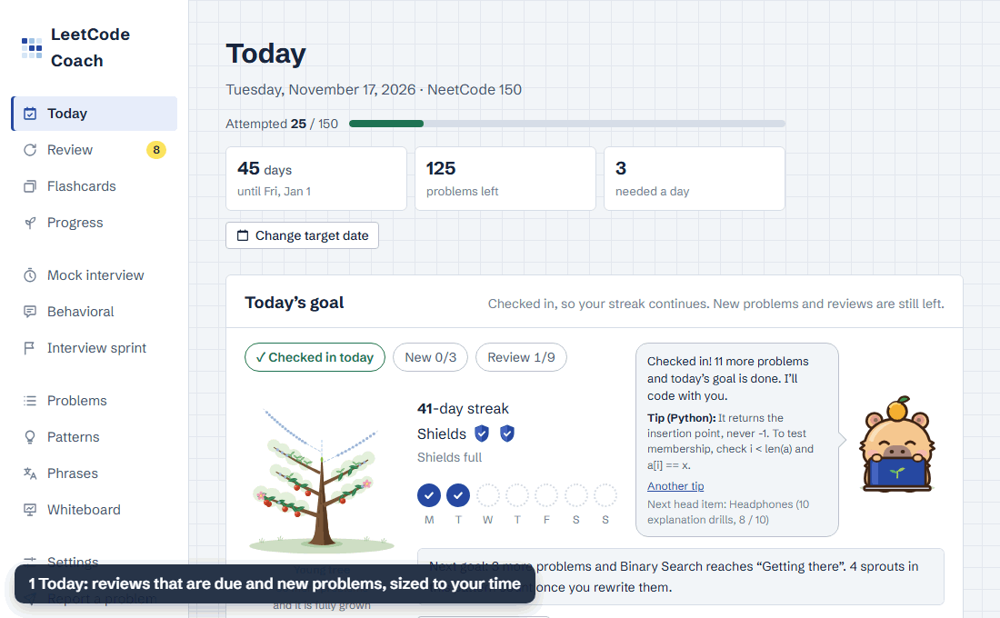
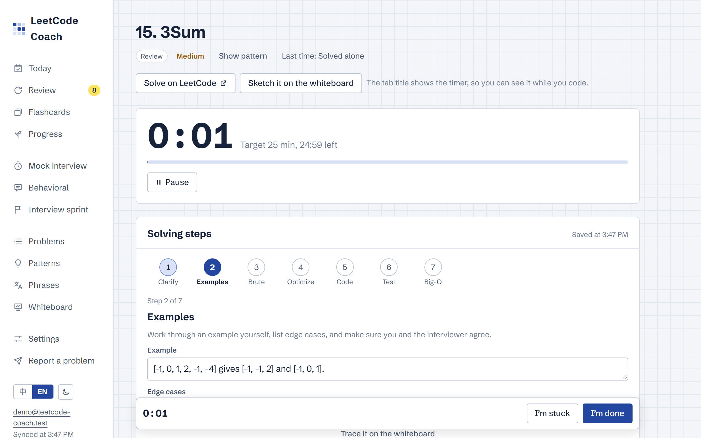
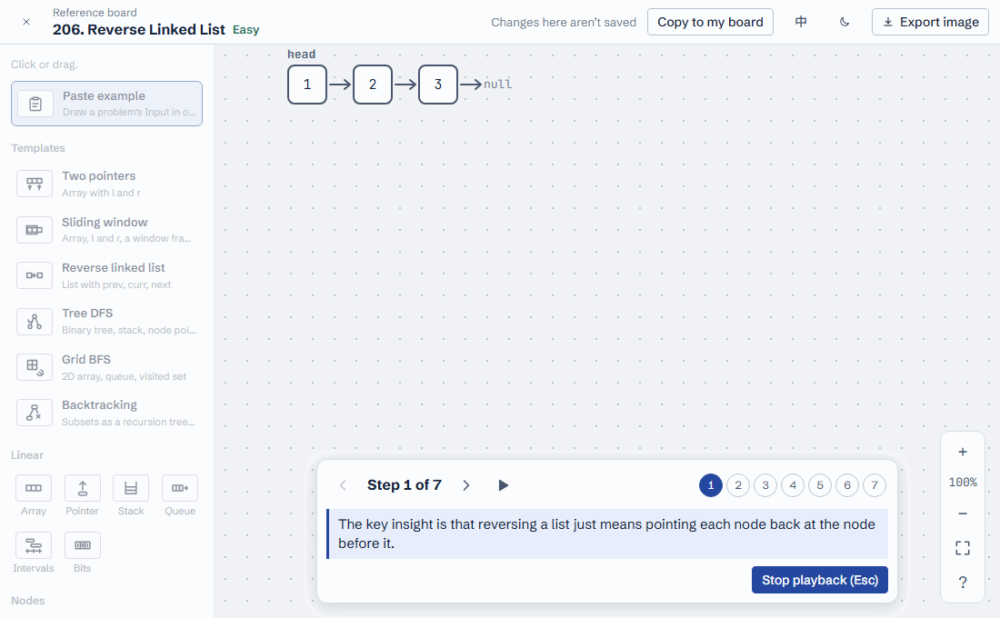
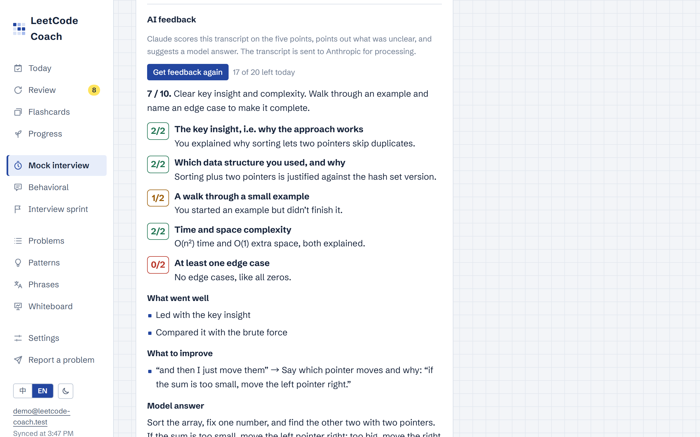
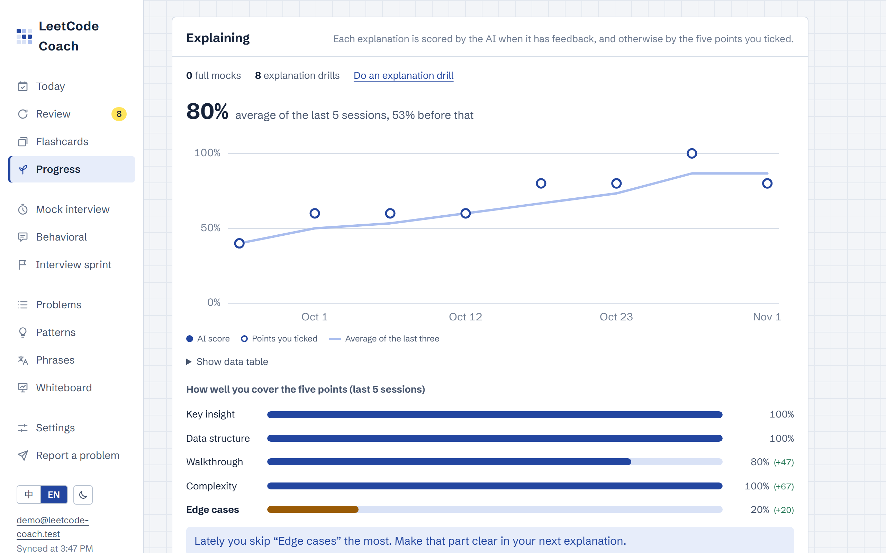
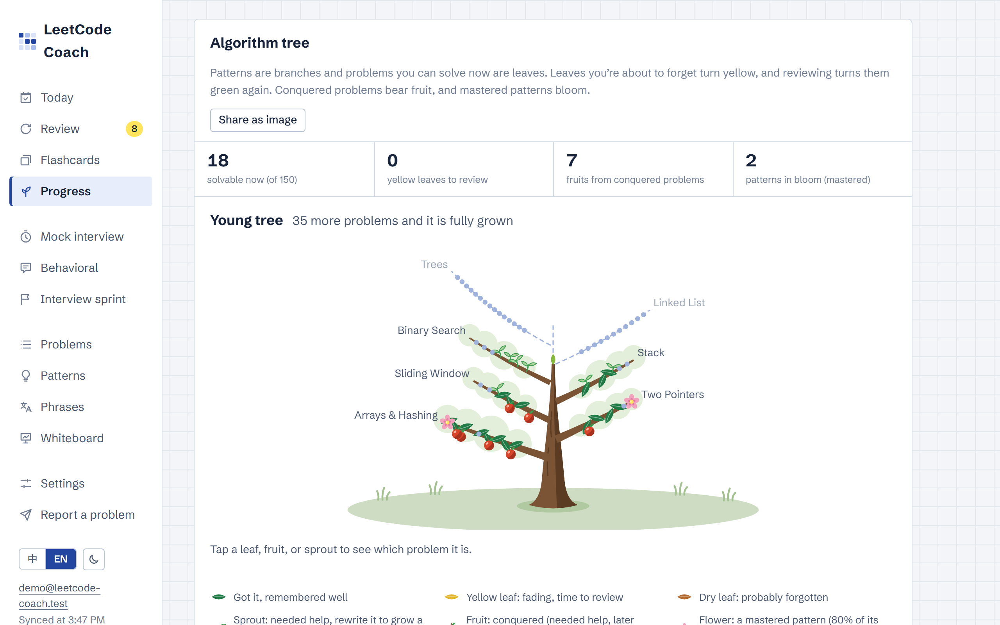

# LeetCode Coach（刷題教練）

**English** · [中文](README.zh-TW.md)

A study coach for coding interviews. You solve problems on LeetCode; it plans what to practice each day, schedules each review for just before you'd forget, and trains you to explain solutions out loud in English, with AI feedback.

Solo project, live at [coach.legoli.dev](https://coach.legoli.dev), with 440+ unit and API tests and 130+ end-to-end tests.

**[Try it with demo data](https://coach.legoli.dev/?demo)** (six weeks of made-up practice, no sign-up) · **[Whiteboard example](https://dsaboard.legoli.dev/#example=206)**

<picture><source media="(prefers-color-scheme: dark)" srcset="docs/images/tour-dark.gif"></picture>

- **Reviews right before you'd forget.** Each review is timed from how long you took, how many hints you opened, and where you got stuck, not just a self-rating, and the app tells you why it picked that day.
- **Practice saying it.** Explain your solution out loud (or type it). Claude scores five points an interviewer listens for and asks follow-up questions.
- **Works offline, no account needed.** Everything is saved in your browser first; signing in syncs it between devices.

Built with React 19, TypeScript, Hono, PostgreSQL, Cloudflare Workers and Durable Objects, the Claude API, and Playwright.

## What it does

A day with the app, in the order you'd use it:

1. **Today** lists the reviews that are due and new problems from NeetCode 150, Blind 75, or Grind 169 (213 problems in 18 patterns), sized to your time. An **interview sprint** plans every day up to an interview date.
2. **Practice** on LeetCode with a timer, the seven interview steps (one line of notes each), and hints that open one layer at a time.
3. **Record** how it went and where you got stuck. FSRS picks the next review and shows why it's that many days away.
4. **Explain** the solution out loud in English, or typed. Claude scores five points, suggests a better answer, and can play the interviewer with follow-up questions. Your own API key, or your own ChatGPT or Claude chat, works too.
5. **Whiteboard** an idea with 20+ draggable data structures, or watch the problem's **reference board**: every one of the 213 problems has one that plays the solution step by step, with the words you'd say under each step. A board can be shared for live co-editing.
6. **Behavioral** stories in STAR form, practiced out loud with AI feedback.
7. **Flashcards** for spare minutes: five tap-only cards, about a minute.
8. **Progress**: an algorithm tree that grows as you practice and fades as you forget, a capybara that grows with your streak, readiness by difficulty and company, and how your explanations improve.

The whole app is in English and Traditional Chinese. Every feature is described in [docs/features.md](docs/features.md).

<table>
  <tr>
    <td width="50%"><picture><source media="(prefers-color-scheme: dark)" srcset="docs/images/practice-dark.png"></picture><br><b>Timed practice</b>: a timer, the interview steps one at a time with a line of notes each, and <i>I'm stuck</i> and <i>I'm done</i> always at hand.</td>
    <td width="50%"><picture><source media="(prefers-color-scheme: dark)" srcset="docs/images/reference-board-dark.gif"></picture><br><b>Reference boards</b>: every problem's solution plays step by step, with one line of the explanation under each step.</td>
  </tr>
  <tr>
    <td width="50%"><picture><source media="(prefers-color-scheme: dark)" srcset="docs/images/ai-feedback-dark.png"></picture><br><b>Explaining out loud</b>: a live transcript, then Claude scores it on five points and suggests a model answer.</td>
    <td width="50%"><picture><source media="(prefers-color-scheme: dark)" srcset="docs/images/explaining-dark.png"></picture><br><b>Explaining progress</b>: every drill's score over time, how well you cover each of the five points, and the one you skip most.</td>
  </tr>
  <tr>
    <td width="50%"><picture><source media="(prefers-color-scheme: dark)" srcset="docs/images/progress-dark.png"></picture><br><b>Algorithm tree</b>: patterns are branches and problems you can solve are leaves. Leaves fade as you forget, conquered problems bear fruit, and mastered patterns bloom.</td>
    <td width="50%"><picture><source media="(prefers-color-scheme: dark)" srcset="docs/images/capybara-day-dark.svg"></picture><br><b>Capybara</b>: it naps until you practice, codes along until today's goal is done, then celebrates. It grows with you and collects head items.</td>
  </tr>
</table>

## Engineering highlights

- **Offline-first sync.** Every write goes to IndexedDB together with an outbox entry, in one transaction. A single `POST /api/sync` pushes and pulls. Each record is last-write-wins with tombstones for deletes, and server versions come from a Postgres sequence under a per-user advisory lock, so a cursor never skips a change. Review schedules aren't synced at all: they're rebuilt by replaying attempts. [How sync works](docs/architecture.md#offline-first-sync)
- **Scheduling with evidence.** FSRS-6 is written from the formulas and checked against the official `ts-fsrs` on hundreds of random histories. On top of it, time, hint depth, and stuck reasons weight each attempt, and shaky solves come back within a week. The same code produces the on-screen "Why this many days?" breakdown. [Review scheduling](docs/scheduling.md)
- **A whiteboard published as a package.** [dsa-whiteboard](https://github.com/Lego514/dsa-whiteboard) is a custom editor with no drawing library, released to npm with provenance from GitHub Actions. Live rooms run on one Cloudflare Durable Object each. Tests check that each of the 213 reference boards follows its reference explanation, step by step.
- **AI with guardrails.** Claude Opus 5.5 returns JSON-schema structured output, behind an allow-list and a per-user daily quota. The same prompts and schemas (`shared/ai.ts`) run in the browser with your own key, which never reaches the server.
- **Security.** scrypt password hashes, only hashed session tokens stored, `__Host-` cookies, CSRF blocked by content type and Origin checks, rate limits, Sign in with GitHub using PKCE, a zod schema for every synced record, and a Content-Security-Policy that runs only the site's own scripts. [Security](docs/architecture.md#security)
- **Tested like production.** Playwright runs against the production build and a real PostgreSQL 17 on Chromium and iPhone WebKit, with a fake GitHub for the OAuth flow and two browsers syncing with each other. CI also builds the Docker image and tests the running container.
- **Fast on free hosting.** Cloudflare Workers serve the web app from the edge, and a small Worker forwards `/api` to the Node API on Render on the same origin, so only sign-in and sync wait for the free server to wake.

## Tech stack

| Area | Choice |
| --- | --- |
| Web app | React 19, TypeScript (strict), React Router 8, hand-written CSS with design tokens, typed i18n dictionaries |
| Build | Vite 8 with route-level code splitting, PWA through `vite-plugin-pwa` |
| Local data | IndexedDB through Dexie 4 |
| API | Node 24, Hono, zod schemas shared with the web app |
| Database | PostgreSQL (Neon) through Drizzle ORM; PGlite for development and tests |
| Whiteboard | [dsa-whiteboard](https://www.npmjs.com/package/dsa-whiteboard), my own package |
| AI | Claude Opus 5.5 through the Anthropic SDK; or your own Anthropic, OpenAI, or OpenRouter key |
| Auth | Email and password (scrypt), Sign in with GitHub (OAuth 2.0 with PKCE) |
| Hosting | Cloudflare Workers (web app, whiteboard rooms), Render (API), Neon (database) |
| Monitoring | Sentry, errors only, with personal data kept out |
| Quality | Vitest, Playwright, ESLint, GitHub Actions, Docker Compose |

Each choice is explained in [the detailed table](docs/architecture.md#tech-stack-in-detail).

## Architecture

![Architecture: the React PWA keeps data in IndexedDB. Cloudflare Workers serve it and forward /api to a Hono API on Render, which stores data in Neon PostgreSQL and calls Claude for feedback, GitHub for sign-in, Brevo for email, and browser push services for reminders. With your own key the browser calls the AI provider directly. The whiteboard connects over WebSockets to Cloudflare Durable Objects for live co-editing. Sentry receives errors. GitHub Actions tests every change, including a Docker container, before deploying](docs/architecture.svg)

The code map, sync protocol, data model (with ER diagrams), and security notes are in [docs/architecture.md](docs/architecture.md).

## Run it locally

Requires Node 24. There's no database to install: development uses an embedded PGlite. (The hosted API runs on a free plan that sleeps when idle, so the first sign-in or sync after a quiet while can take up to a minute; the app itself keeps working.)

```bash
npm install
npm run dev    # web on http://localhost:5173, API on http://localhost:8787
npm test       # unit, API, and two-device sync tests
```

`docker compose up --build` runs the production build with PostgreSQL at http://localhost:8080. All commands and the end-to-end tests are in [docs/development.md](docs/development.md).

## Documentation

- [Features](docs/features.md): everything the app does, in detail
- [Architecture](docs/architecture.md): code map, offline-first sync, data model, security, tech stack
- [Review scheduling](docs/scheduling.md): FSRS-6 and the weights on top of it
- [Design decisions](docs/decisions.md): eight key choices, what each gave up, and what it costs
- [Development](docs/development.md): commands, tests, Docker
- [Deploying](docs/deploying.md): Render, Neon, Cloudflare, and the optional services
- [Data and privacy](docs/privacy.md): what is stored where

## License

[MIT](LICENSE)
