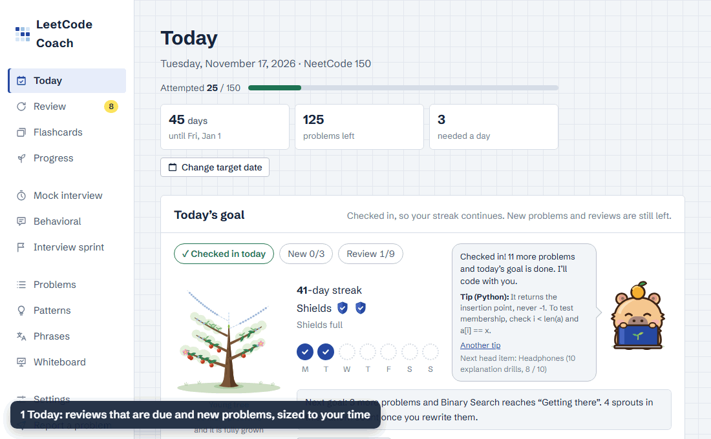
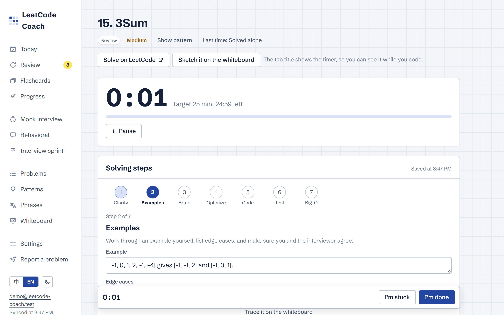
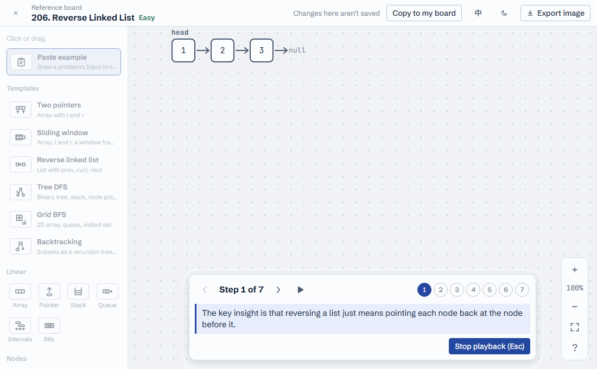
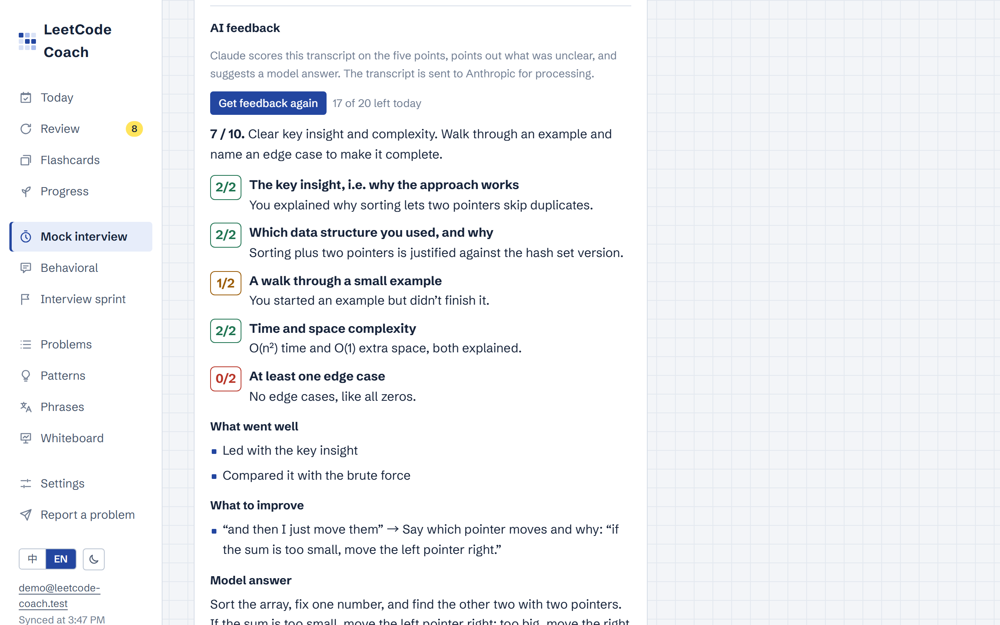
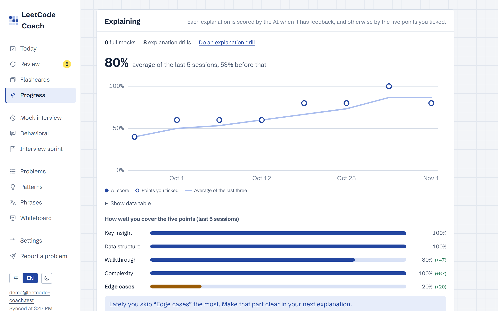
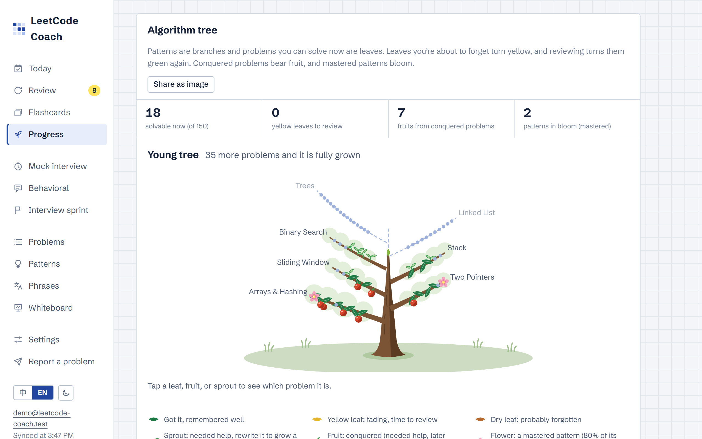

# LeetCode Coach（刷題教練）

[English](README.md) · **中文**

準備程式面試的刷題教練。題目還是在 LeetCode 上寫，這個 App 決定每天練什麼、在你快忘記之前排好複習，並讓你練習用英文把解法講出來，拿 AI 的回饋。

一個人做的專案，正式上線在 [coach.legoli.dev](https://coach.legoli.dev)，有 440 多個單元和 API 測試、130 多個端對端測試。

**[用示範資料試用](https://coach.legoli.dev/?demo)**（六週編出來的練習紀錄，不用註冊）· **[白板範例](https://dsaboard.legoli.dev/#example=206)**

<picture><source media="(prefers-color-scheme: dark)" srcset="docs/images/tour-dark.gif"></picture>

- **在快忘記之前複習**：看你花了多久、打開幾層提示、卡在哪裡來排下一次複習，不只看自己按的評分；每次都告訴你為什麼排那一天。
- **練習講出來**：用講的（或打字）解釋解法，Claude 依面試官會聽的五個重點打分數，還會追問。
- **離線也能用、不用帳號**：所有東西先存在你的瀏覽器，登入後在不同裝置之間同步。

用到的技術：React 19、TypeScript、Hono、PostgreSQL、Cloudflare Workers 和 Durable Objects、Claude API、Playwright。

## 能做什麼

照一天用的順序：

1. **今天**：列出到期的複習，和從 NeetCode 150、Blind 75、Grind 169（共 213 題、18 個模式）挑的新題，照你有的時間排。**面試衝刺**會排好到面試那天以前的每一天。
2. **練習**：在 LeetCode 寫題，這裡計時、照面試的七個步驟各寫一句想法，提示一層一層打開。
3. **記錄**：寫得怎麼樣、卡在哪。FSRS 排下一次複習，也寫出為什麼隔這幾天。
4. **講解**：用英文講一次解法（也可以打字）。Claude 依五個重點打分數、給更好的講法，還能扮演面試官追問。也可以用自己的 API 金鑰，或自己的 ChatGPT、Claude 對話。
5. **白板**：拖拉 20 多種資料結構把想法畫出來，或看這題的**參考板書**：213 題每一題都有，一步一步播放解法，每一步下面是該講的那句話。白板也能共用、一起編輯。
6. **行為面試**：用 STAR 寫故事，開口練習並拿 AI 回饋。
7. **微複習**：零碎時間用，一回合 5 張只要點的卡片，大約一分鐘。
8. **進度**：跟著練習長大、忘了會變黃的演算法樹，跟著連續天數長大的卡皮巴拉，依難度和公司看的準備度，以及講解能力的進步曲線。

整個 App 有繁體中文和英文。每一個功能的說明在 [docs/features.zh-TW.md](docs/features.zh-TW.md)。

<table>
  <tr>
    <td width="50%"><picture><source media="(prefers-color-scheme: dark)" srcset="docs/images/practice-dark.png"></picture><br><b>計時練習</b>：計時器、面試步驟一次一步，每一步寫一句；「我卡住了」「寫完了」隨時按得到。</td>
    <td width="50%"><picture><source media="(prefers-color-scheme: dark)" srcset="docs/images/reference-board-dark.gif"></picture><br><b>參考板書</b>：每一題的解法一步一步播放，每一步下面是一句講法。</td>
  </tr>
  <tr>
    <td width="50%"><picture><source media="(prefers-color-scheme: dark)" srcset="docs/images/ai-feedback-dark.png"></picture><br><b>用英文講出來</b>：即時逐字稿，講完 Claude 依五個重點打分數並給參考講法。</td>
    <td width="50%"><picture><source media="(prefers-color-scheme: dark)" srcset="docs/images/explaining-dark.png"></picture><br><b>講解能力</b>：每次練習的分數、五個重點各講到幾成、最常漏掉哪一個。</td>
  </tr>
  <tr>
    <td width="50%"><picture><source media="(prefers-color-scheme: dark)" srcset="docs/images/progress-dark.png"></picture><br><b>演算法樹</b>：模式是樹枝，會了的題目是葉子；快忘了會變黃，征服的題目結果實，熟練的模式開花。</td>
    <td width="50%"><picture><source media="(prefers-color-scheme: dark)" srcset="docs/images/capybara-day-dark.svg"></picture><br><b>卡皮巴拉</b>：還沒練習時睡覺、陪你寫到做完今天的目標，再一起慶祝；會長大，也會收集頭飾。</td>
  </tr>
</table>

## 技術上的重點

- **離線優先的同步**：每次寫入都在同一個交易裡存進 IndexedDB、記進待上傳清單（outbox）。一個 `POST /api/sync` 同時上傳和下載；每筆紀錄 last-write-wins，刪除留墓碑；伺服器的版本號來自 Postgres sequence，並在每個使用者的 advisory lock 下配發，下載的游標不會漏掉任何改動。複習排程不同步，從練習紀錄重播算出來。[同步怎麼做](docs/architecture.md#offline-first-sync)
- **有證據的排程**：照公式自己寫 FSRS-6，測試裡跟官方的 `ts-fsrs` 在幾百組隨機紀錄上比對；再用寫題時間、提示深度、卡在哪調整每一次，寫得不順的一週內再確認。畫面上的「為什麼隔這幾天」跟排程用同一份程式。[複習排程](docs/scheduling.md)
- **白板發佈成套件**：[dsa-whiteboard](https://github.com/Lego514/dsa-whiteboard) 不用任何繪圖函式庫，從 GitHub Actions 帶 provenance 發佈到 npm；共用的房間一個 Cloudflare Durable Object。213 題的參考板書，測試會檢查每一步都照參考講解的順序。
- **有防護的 AI**：Claude Opus 5.5 用 JSON schema 輸出結構化結果，伺服器有允許名單和每人每天的額度。同一份提示詞和 schema（`shared/ai.ts`）也在瀏覽器裡配使用者自己的金鑰跑，金鑰不會送到伺服器。
- **安全**：scrypt 雜湊密碼、只存 session token 的雜湊、`__Host-` cookie、用 Content-Type 和 Origin 擋 CSRF、限流、用 PKCE 的 GitHub 登入、每一種同步的紀錄都有 zod schema 檢查，還有只讓網站自己的程式執行的 Content-Security-Policy。[安全](docs/architecture.md#security)
- **照正式環境測**：Playwright 對正式建置和真的 PostgreSQL 17，在 Chromium 和 iPhone WebKit 上跑，用假的 GitHub 測 OAuth，也測兩個瀏覽器互相同步；CI 還會建 Docker 映像、對跑起來的容器測。
- **免費方案也秒開**：網頁由 Cloudflare Workers 從邊緣送出，`/api` 由一個小 Worker 在同一個網址轉給 Render 上的 Node API，只有登入和同步要等免費的伺服器醒來。

技術選擇的表在英文 README 的 [Tech stack](README.md#tech-stack)，每一項的理由在 [docs/architecture.md](docs/architecture.md#tech-stack-in-detail)。

## 本機執行

需要 Node 24。不用另外裝資料庫，開發時用內建的 PGlite。（線上的 API 用免費方案，閒置一陣子會休眠，之後第一次登入或同步最多要等一分鐘；App 本身照常能用。）

```bash
npm install
npm run dev    # 網頁 http://localhost:5173，API http://localhost:8787
npm test       # 單元、API 和兩台裝置同步的測試
```

`docker compose up --build` 會把正式版和 PostgreSQL 一起跑在 http://localhost:8080。

## 文件

- [功能](docs/features.zh-TW.md)：每一個功能的說明
- [設計上的決定](docs/decisions.zh-TW.md)：八個關鍵的選擇、各放棄了什麼、代價是什麼
- [開發和部署](docs/deploying.zh-TW.md)：本機開發、Docker、部署到 Render、Neon、Cloudflare，和選用的服務
- 英文的技術文件：[Architecture](docs/architecture.md)（程式結構、同步、資料模型、安全）、[Review scheduling](docs/scheduling.md)、[Development](docs/development.md)、[Deploying](docs/deploying.md)、[Data and privacy](docs/privacy.md)

## 授權

[MIT](LICENSE)
