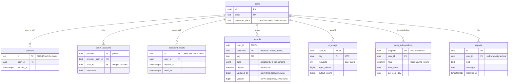
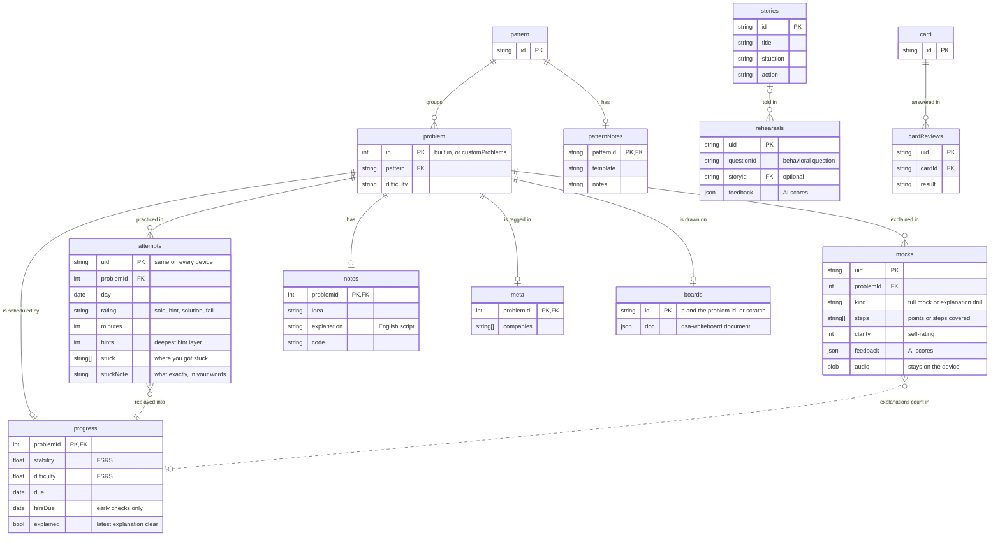

# Architecture

How the app is built: the code map, offline-first sync, the data model, and security. Review scheduling has [its own page](scheduling.md). Back to the [README](../README.md).

![Architecture: a React PWA stores data in IndexedDB and is served by Cloudflare Workers, which forward /api to a Hono API on Render that syncs to Neon PostgreSQL; the API calls Claude for feedback, GitHub for sign-in, Brevo for email, and browser push services for daily reminders; with your own key the browser calls the AI provider directly; the whiteboard connects over WebSockets to Cloudflare Workers for live co-editing; Sentry receives errors; GitHub Actions tests every change, including a Docker container, before Render deploys, and wakes the API hourly to send reminders](architecture.svg)

```
src/                 Web app
  data/                Static content: problems, lists, patterns, hints, edge cases, summaries, reference explanations, Python tips, interview steps and phrases, behavioral questions
  lib/                 Pure logic: scheduler (FSRS), dates, stats, catalog, practice session
    cards.ts             Flashcards: deck, Leitner boxes, picking and dealing a round
    motivation.ts        Today's goal, readiness, pattern levels, wins, weekly recap
    tree.ts              Algorithm tree: shape, growth stages, and how each problem looks
    companion.ts         Capybara: growth, head items, today's pose
    explainProgress.ts   Explanation scores over time
  store/               Data layer
    db.ts                Dexie schema (v2: sync ids, outbox, sync state; v3: flashcard answers; v4: whiteboards; v5: FSRS rebuild; v6–7: behavioral stories and practice)
    actions.ts           Every local write; each one also records a change in the outbox
    queries.ts           Every read, as React hooks
    tracking.ts          Local record ⇄ sync payload conversion, schedule replay
    progress.ts          Rebuilds a problem's FSRS state from its attempts
    sync.ts              Sync engine (push outbox, pull changes, apply)
    cloud.ts             Account state and automatic sync scheduling
    ownAi.ts             Your own AI key, in local storage only (never synced)
  i18n/                Locale detection, typed dictionaries (zh-TW, en), date formatting
  components/, pages/  UI (components/board/ wires the dsa-whiteboard package to storage, sync, and explain mode)
shared/              Code used by both sides: ids, the zod request/response schemas, streak rules, AI prompts and output schemas
server/              API
  src/app.ts           Hono app: security middleware, routes, static files
  src/env.ts           Settings from environment variables, and which features are on
  src/auth/            Password hashing, sessions, password reset, Sign in with GitHub, rate limiting, auth routes
  src/mail/            Brevo email client and the reset message
  src/push/            Daily reminders: Web Push subscriptions and the hourly send
  src/sync/            Sync endpoint and last-write-wins upserts
  src/ai/              Explanation, follow-up, and behavioral feedback through Claude, quota-limited routes
  src/reports/         Bug reports and the admin inbox
  src/monitoring.ts    Sentry, with personal data kept out
  src/db/              Drizzle schema, database client (PostgreSQL or PGlite), migration runner
  migrations/          Plain SQL migrations, applied in order at startup
  test/                API tests and two-device end-to-end sync tests
e2e/                 Playwright tests: practice and review, mock interview with a transcript, flashcards, whiteboard, the tree and the capybara, language, sync between two browsers; fake-github.mjs stands in for GitHub
scripts/screenshots/ README screenshots from demo data, and the capybara animation
```

On Render, one Node service serves both `/api` and the built web app. On Cloudflare, a Worker (`edge/worker.ts`) serves the same build from the edge, so it never waits for the free Render service to wake, and forwards `/api/*` to Render with cookies, redirects, and the client IP. Either way the browser only talks to its own origin, so the session cookie can be `SameSite=Lax` and the API needs no CORS. In development, Vite proxies `/api` to the API server.

## Offline-first sync

- **Writes are local first.** Every write goes to IndexedDB, together with an entry in an *outbox* in the same transaction. The outbox keeps one entry per record, with the time of the latest local change.
- **One request pushes and pulls.** `POST /api/sync` sends up to 500 outbox changes and the client's cursor. The server applies the changes, then returns every record whose version is newer than the cursor.
- **Conflicts: last write wins.** The server keeps one row per `(user, collection, key)` in a JSONB document table. An upsert replaces a row only if the incoming change is strictly newer. Rejected changes come back with the server's current copy.
- **Deletes are tombstones**, so every device learns about them and an older write cannot bring a record back.
- **Server versions come from a Postgres sequence.** Each user's sync runs under a transaction-scoped advisory lock, so versions are assigned in commit order and a cursor never skips a change.
- **Stale pulls never overwrite newer local edits.** When a pulled change arrives, the client keeps its own version if an outbox entry for that record is newer.
- **Review schedules are not synced.** They are rebuilt by replaying attempts in time order, so two devices practicing offline never overwrite each other's schedule. Flashcard schedules are rebuilt the same way from the answers.
- **First sign-in merges existing data.** On a device that already has local data, every record is queued for upload:
  - Records with a real modification time (attempts, mock sessions, notes, pattern notes, flashcard answers, whiteboards, behavioral stories and practice) keep it.
  - Records without one (settings, tags, custom problems) are sent with time 0. If the account already has that record, the account's version wins.
- **Audio recordings stay on the device.**

Known limitation: conflicts are decided by each device's clock.

## Data model

The server keeps accounts in ordinary relational tables. Everything you create lives in one document table, `records`, keyed by user, collection, and key. A new kind of data is a new collection with a zod schema in `shared/protocol.ts`, not a migration.



In the browser, each collection is an IndexedDB table, and every row is one `records` document. Problems, patterns, and flashcards ship with the app (your own problems are the `customProblems` collection). The review schedule, `progress`, is never stored on the server: it is rebuilt by replaying a problem's attempts, and its clear explanations decide Easy and Mastered (dashed lines).



`settings` is a single record. Two more tables never sync: `outbox` holds one pending change per record, and `syncState` holds the account and the sync cursor.

## Security

- **Passwords** are hashed with scrypt (N=2^15) and a random salt. A failed login for an unknown email still runs a dummy hash, so response times don't reveal which emails are registered.
- **Session tokens** are random 256-bit values. The database stores only their SHA-256 hash.
- **The session cookie** is `HttpOnly` and `SameSite=Lax`. In production it is also `Secure` and uses the `__Host-` prefix. Sessions last 30 days and renew when used.
- **CSRF**: writes must be `application/json`, which a cross-site browser request can't send without a CORS preflight that this API never grants. Requests from foreign `Origin`s and requests marked `Sec-Fetch-Site: cross-site` are rejected.
- **Rate limits** apply to registration, to login attempts (per IP, per IP-plus-email, and per email alone, because the client IP comes from `X-Forwarded-For` and a client that reaches the API directly can change it on every request), to password reset requests (per IP and per email), to reports, to starting a GitHub sign-in, and to bursts of AI requests.
- **Sign in with GitHub** uses the OAuth 2.0 authorization code flow with PKCE (S256). The `state` and the PKCE verifier live in a short-lived `HttpOnly`, `SameSite=Lax` cookie in the browser that started the sign-in, so a callback from anywhere else does nothing. Only a verified GitHub email can create an account, and an email that is already registered is never merged automatically (that would let anyone who controls a GitHub account with your email take over yours): you sign in with your password and connect GitHub from the Account page. GitHub can't be disconnected from an account without a password, and a GitHub-only account confirms deletion by typing its email.
- **Content-Security-Policy**: the build puts the policy in a `<meta>` tag in `index.html` (`src/lib/csp.ts`), so Cloudflare and the Node server serve the same one. Scripts run only from the site itself and from Cloudflare Web Analytics, which Cloudflare adds to the pages it serves (`script-src 'self' https://static.cloudflareinsights.com`, no inline scripts, no eval). Cloudflare already serves every file of the site, so allowing its script doesn't trust anyone new. The browser can connect only to the API, the AI providers used with your own key, the whiteboard server, Sentry, and Cloudflare's analytics endpoint. This matters because your own AI key sits in localStorage, where any script on the page could read it. Styles allow `'unsafe-inline'` because React and the whiteboard set `style` attributes. `e2e/security.spec.ts` visits every page and fails on any violation.
- **Page headers** (`shared/securityHeaders.ts`, the same in `public/_headers` for Cloudflare): `frame-ancestors 'none'` and `X-Frame-Options: DENY` against clickjacking, `nosniff`, a strict referrer policy, a `Permissions-Policy` that allows only the microphone, `Cross-Origin-Opener-Policy`, and HSTS.
- **Other protections**: request bodies are size-limited, API responses get Hono's `secureHeaders` and `no-store`.
- **Input validation**: every synced record is checked against a per-collection zod schema, and unknown fields are dropped.

## Tech stack in detail

| Area | Choice |
| --- | --- |
| UI | React 19, TypeScript (strict), hand-written CSS with design tokens |
| Build | Vite 8, route-level code splitting, `vite-plugin-pwa` |
| i18n | Typed dictionaries without a library: the English dictionary must match the Chinese one key for key, and sentences with links use inline tags |
| Routing | React Router 8 data router (lazy routes, navigation blocking during practice and mock sessions) |
| Local storage | IndexedDB via Dexie 4, reactive reads with `useLiveQuery` |
| API | Node 24, Hono, zod validation shared with the client |
| Database | PostgreSQL through Drizzle ORM; embedded PGlite for local development and tests |
| Whiteboard | [dsa-whiteboard](https://github.com/Lego514/dsa-whiteboard), my own package in a separate repo, published on [npm](https://www.npmjs.com/package/dsa-whiteboard) with provenance from GitHub Actions: a custom editor with no drawing library (HTML elements in a CSS-transformed world, arrows and ink in SVG, pointer capture and pinch), with all geometry and editing logic as unit-tested pure functions |
| Illustrations | Drawn in code as SVG React components (the algorithm tree, the capybara and its poses, empty-state art), colored with CSS variables for both themes; the README's capybara animation is generated from the same component |
| Quality | Vitest (unit, API, and two-device sync tests), Playwright end-to-end tests against the production build and a real PostgreSQL on Chromium and iPhone WebKit, ESLint, GitHub Actions CI |
| AI | Claude Opus 5.5 through the Anthropic TypeScript SDK, JSON-schema structured output, server-side refusal fallback, per-user daily quota stored in PostgreSQL. With your own key, the browser calls Anthropic (the same SDK), OpenAI, or OpenRouter directly, using the same prompts and schemas (`shared/ai.ts`) |
| Hosting | The web app on Cloudflare Workers static assets (served from the edge, never asleep), with a small Worker proxying `/api` to the Node API on Render; Neon PostgreSQL |
| Auth | Email and password (scrypt, only hashed session tokens stored) plus Sign in with GitHub (OAuth 2.0 authorization code flow with PKCE, explicit account linking); a fake GitHub server covers the whole flow in end-to-end tests |
| Monitoring | Sentry for the React app and the Hono API: errors only (no tracing), loaded only when a DSN is set, with account info, cookies, headers, request bodies, query strings, AI inputs and outputs, and local variables kept out; source maps are uploaded at build time and not published |
| Containers | Multi-stage Dockerfile (build, then a slim runtime that runs as a non-root user with a health check) and Docker Compose with PostgreSQL; CI builds the image, starts it with Compose, and runs end-to-end tests against the container |
