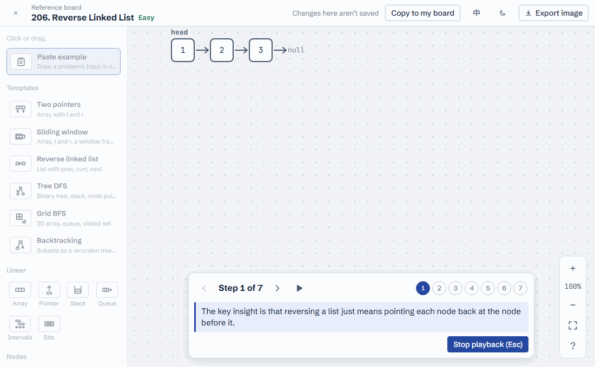
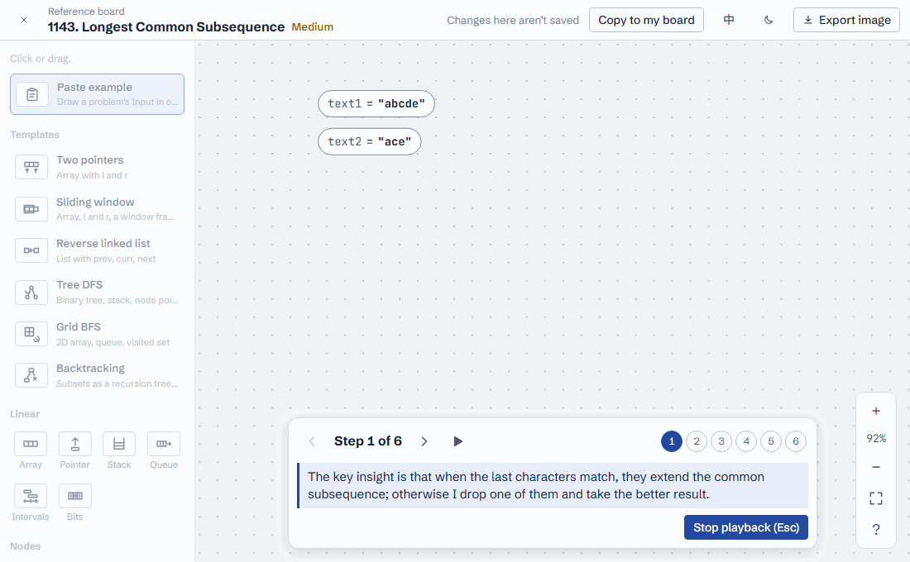
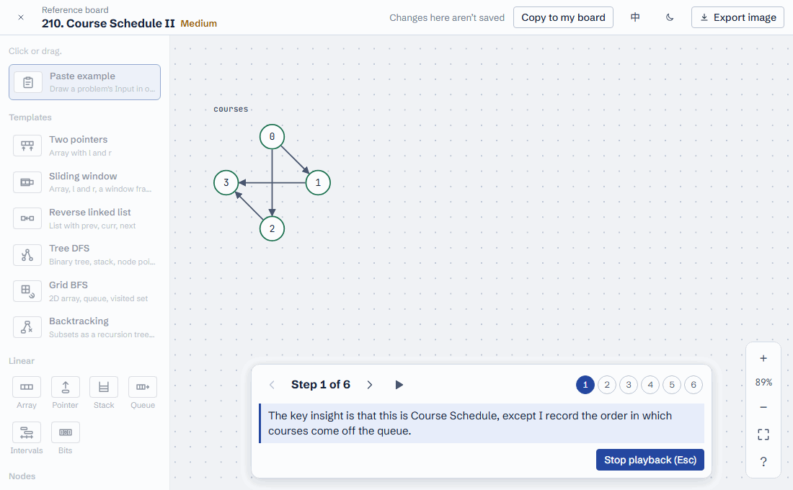

# Features

Everything LeetCode Coach does, in detail. Back to the [README](../README.md). 中文版：[功能](features.zh-TW.md)。

## Reference boards

<picture><source media="(prefers-color-scheme: dark)" srcset="images/reference-board-dark.gif"></picture>

**Reference boards**: every problem in the bank comes with a finished whiteboard that plays step by step. Each step's caption is a line of the problem's reference explanation, so you see the board and the words you'd say together.

<table>
  <tr>
    <td width="50%"><picture><source media="(prefers-color-scheme: dark)" srcset="images/reference-board-dp-dark.gif"></picture> <b>Dynamic programming</b>: Longest Common Subsequence fills its table cell by cell, with arrows to the cells each value comes from.</td>
    <td width="50%"><picture><source media="(prefers-color-scheme: dark)" srcset="images/reference-board-graph-dark.gif"></picture> <b>Graphs</b>: Course Schedule II takes each course as its indegree drops to zero, filling the queue and the order.</td>
  </tr>
</table>

Screenshots use generated demo data and are regenerated with `npm run screenshots`, along with the reference board animations. They follow your GitHub theme (light or dark). The capybara animation is an SVG drawn from the app's own component and text.

## All features

- **Study lists**: NeetCode 150, Blind 75 and Grind 169 (213 unique problems), grouped into 18 patterns. You can add any other LeetCode problem. New problems come either pattern by pattern (the NeetCode roadmap) or in Grind's suggested order (easy, foundational problems first, Hard and Premium later, rotating through patterns); Grind 169 starts in Grind's order. Without LeetCode Premium, one switch leaves out the Premium problems you haven't started, from the daily plan, the sprint, mock interviews, and the problem list.
- **Interview sprint**: enter the interview date, the company (optional), and how many minutes you have on weekdays and weekends. Every day until the interview gets a plan, and the last days (2 by default) are review only.
  - New problems come in priority order: problems tagged with the company, then one problem from each pattern you haven't touched, then two more from each weak pattern (average mastery under 40%, or stuck at least twice in the last 30 days), then the rest of your list. Each day takes as many as fit after its reviews, using rough times (a new problem takes its practice-timer target: Easy 15, Medium 25, Hard 40 minutes; 10 per review, 45 for a mock interview, 15 for behavioral practice). A problem that doesn't fit waits for the next day instead of a shorter one jumping ahead, so a day can end with spare minutes; 10 or more are suggested for explanation practice (today's links to the drill). Problems that don't fit at all are listed, with how long they'd take, instead of crammed in.
  - Reviews are forecast with FSRS, including the first reviews of problems you'll learn during the sprint. A problem you'd remember with less than 90% chance on the interview day is pulled into the review-only days.
  - One full mock interview two days before (and every week before that), and behavioral practice every three days ending the day before. Today shows the countdown, today's minutes, and these to-dos.
  - Paste problem numbers, links, or titles to tag a company's problems in one go, which also works for noting what came up after the interview.
  - Nothing is stored except the settings: the plan is recalculated from your progress every day, so a missed day spreads over the days left.
- **Timed practice with tiered hints**:
  - Starting a problem starts a timer against a target time for its difficulty (Easy 15, Medium 25, Hard 40 minutes). The browser tab title shows the timer, so you can see it while you write code on LeetCode.
  - The timer survives a page reload. A bar at the bottom keeps the timer, **I'm stuck**, and **I'm done** in reach while you scroll.
  - If you get stuck, open hints one layer at a time: which pattern to use, a hand-written key insight for each of the 213 problems, the edge cases to check, then the pattern template. A link to the LeetCode solutions comes last.
  - When you finish, the minutes are filled in (you can adjust them) and a self-rating is suggested based on how many hints you used.
- **Solving steps**: practice, mock interviews, and the problem page share the seven interview steps (clarify, examples, brute force, optimize, code, test, complexity), and you write one line per step. On the practice page the steps open one at a time, and you can jump to any of them. Examples split into an example and its edge cases, and Optimize asks three questions: what's slow, what's repeated, and what to keep. The lines are saved with the problem's notes and synced, so a review starts from how you thought it through, not just the code. In a mock interview they sit under each step's checklist.
  - **Write the script from your steps**: a dialog lays out the five sentences of the English explanation script, each with the step notes that feed it (for example, the edge-case sentence shows your edge cases). You write each sentence yourself, which is the practice, and save it as the problem's script.
  - **Hints that start from where you're stuck**: pick the step you're stuck on to see how to think about it, next to what you wrote in the step before. This doesn't count as a hint. Some steps jump straight to the matching layer: Examples and Test to the edge cases, Optimize to the key insight, and Code to the template.
- **Spaced repetition with FSRS**: after each attempt you rate yourself (solved alone / needed a hint / read the solution / still stuck), and FSRS, the scheduler Anki uses, picks the next review date.
  - Each problem has a stability (days until your chance of remembering it drops to 90%) and a difficulty from 1 to 10. Solved alone counts as Good, a hint as Hard, and reading the solution or still being stuck as Again. A review that came late but still went well grows the interval more.
  - Problems come back when you're about as likely to remember them as the target retention in Settings (90% by default; 80–95%). Changing it reschedules every problem.
  - **Time counts too.** Each attempt's minutes are compared with the problem's target time. Within the target it counts fully; past it, the memory gain shrinks steadily, down to 0.6 at twice the target (about what FSRS gives Hard). Finishing early adds nothing extra.
  - **So do hints and where you got stuck.** The deeper the hints went, the less the attempt counts: compared with solving alone, about 0.8 after the pattern hint, 0.6 after the key insight, 0.5 after the edge cases, and 0.4 after the template. No approach, can't optimize, or can't code it means part of it is forgotten (×0.75); syntax / API or logic / edge cases is more of a slip (×0.9). These weights multiply.
  - **Fast and explained clearly counts as Easy.** Solving it alone in half the target time or less, with no hints and nothing ticked as stuck, *and* explaining it clearly within 3 days (before or after), counts as FSRS's Easy, so the interval grows the most. A fast solve without a clear explanation is an ordinary solo solve, and the breakdown suggests explaining it once. "Clear" means an AI score of 80% or more across the five points, or, without AI, all five points ticked and "Smooth".
  - **Stages and mastery squares**: Learning (under 7 days), Reviewing (7–29), Remembered (30 or more), and Mastered (30 or more *and* your latest explanation was clear), one square shade each. A remembered problem that isn't explained yet says so on its page. The shade is how far you got, so it doesn't drop with time; a problem you haven't touched in a while gets an orange dot in the corner instead (hollow when fading, filled when probably forgotten, the same thresholds as the tree's yellow and dry leaves), and hovering it says how many days it's been. Problem lists also show a small "N% recall" tag on every problem you've done, outlined in orange with a hollow dot and filled with a filled one. Progress says how many problems have a dot and links to the Problems list filtered to them (status **Fading**); they're already due, and reviews put the most forgotten first.
  - **Shaky solves come back within a week.** After needing a hint, taking twice the target or longer, or getting stuck with no approach, unable to optimize, or unable to code it, the next review is at most 7 days away, so you confirm it before the interval grows. FSRS's memory estimate is kept, so solving it on time then stretches the next interval out again. Until the day FSRS itself would have picked, such a problem says "Time to check" in gray rather than overdue in red, since you most likely still remember it.
  - **Why this many days?** The record form (once you pick a rating) and the problem page open a step-by-step breakdown: how long since last time and how much you'd still remember, what the rating means in FSRS, each weight with its number, memory before and after, the days at the target retention, and the one-week check if it applies.
  - On the review page, **Explain it now** opens an explanation drill for the problem you're recalling, and saving it brings you back to check your notes and rate it.
  - The review page shows the **next 7 days**: how many reviews come due each day, with anything over the daily cap drawn dashed on top as it moves to later days.
  - The review queue puts the problem you're most likely to have forgotten first. Problem pages show how likely you are to remember it now, how long it holds, its difficulty, and where it sits on the algorithm tree.
  - Past records can be edited or deleted, from **Done today** on Today or the problem's history, and the schedule is rebuilt from what's left.
  - The scheduler is written from the FSRS-6 formulas with the default parameters, and the tests compare it with the official `ts-fsrs` (a test-only dependency) on hundreds of random review histories.
- **Daily plan**: the Today page lists the reviews that are due plus N new problems. By default the new problems are *interleaved*: mostly the pattern you're learning, plus one from another pattern so you practice recognizing which approach fits, and a pattern you've been stuck on lately (solutions read, still stuck, or stuck reasons ticked) gets an extra, easier problem. The pattern isn't shown until you ask, as in an interview. Settings can switch to strictly in order or to focusing on one pattern, and the day's list is planned from the morning's state so it doesn't reshuffle as you work. At the top, a progress bar and three numbers show how much of the list is left, your daily pace, and when you'll finish the first pass. With a target date set, they show the days left and how many new problems a day you need, flagged when your daily goal is too low.
  - Any new problem you start counts toward the daily goal, wherever you start it. **One more problem** adds the next one in roadmap order.
  - Settings can cap how many Medium and Hard problems and how many reviews come each day; the review page lists what's up next beyond today's cap.
  - **Adjust difficulty automatically** (on by default, off during a sprint): when most recent Mediums needed a hint, new problems include fewer Mediums and no Hards until you solve them on your own again. If your list has no Easy problems left, Mediums still fill the daily goal.
  - A review whose last attempt needed a hint or the solution is marked **Rewrite**: write it from scratch, without your notes, until it passes.
  - **Record another problem** finds a problem by number, title, or LeetCode URL. If it isn't in your lists yet, you add its details and record it in the same dialog.
  - **Mark problems I solved before** (on Problems) schedules problems you solved before using the app for review in one go. A big batch is spread out so no more than five problems come due on any day, counting reviews already scheduled. They don't count toward streaks or session totals.
- **Staying motivated**: everything here is calculated from your practice records, so nothing extra is synced; only small choices, like which head item the capybara wears, stay in the browser.
  - **Today's goal**: one problem or one round of flashcards checks you in, and new problems and reviews are counted separately. Every day you practice earns a streak shield (up to two); miss a day and one is used automatically, so the streak doesn't break.
  - **Algorithm tree**: each pattern is a branch and each problem you can solve now is a leaf, colored by how likely you still remember it (FSRS): yellow when it's fading, dry when it's probably forgotten. A problem that needed a hint or the solution is a sprout until you rewrite it on your own. Conquered problems bear fruit, and patterns where 80% of the problems are solid bloom. The tree grows from a seed: it sprouts at the first problem and becomes a sapling at 5, a young tree at 20, and a grown tree at 60. Today shows a small one, Progress the whole tree, and **Share as image** draws it with this week's numbers.
  - **Capybara**: it grows from a baby to a young (7 days of practice) and a grown-up capybara (21 days), and collects ten head items for goals like a 7-day streak, 100 flashcards, or 10 explanation drills. On Today it naps in bed until you practice, codes on a laptop until today's goal is done, then drinks bubble tea or soaks in a hot spring (one or the other each day). On wide screens a speech bubble next to it has an encouraging line, a daily tip (a Python tip or a pattern summary), and the head item you're closest to.
  - **Wins and next goals**: a message celebrates conquering a problem, a pattern leveling up, a new personal best time, the tree's next stage, and new head items. Today names the next goal, such as "3 more problems and Binary Search reaches Getting there", and for the first three days of each week it shows last week's numbers until you dismiss them.
  - Progress also shows your interview readiness (problems you can solve now, overall, by difficulty, and by company tag), a pattern map with each pattern's level, and a weekly recap compared with last week.
- **Daily reminders**: when signed in, pick an hour in Settings, and on days you haven't practiced by then you get a notification (Web Push). Today walks you through turning it on, including adding the app to the home screen on iPhone.
- **Notes**: for each problem you can keep a one-line idea, an English explanation script, time and space complexity, pitfalls, and your code (Python or one of eight other languages). Notes save automatically.
- **Pattern cards**: each pattern has recognition signals, common mistakes, and a Python template you can edit.
- **Interview phrases**: English phrases for each stage of a coding interview, with a self-quiz that hides each phrase until you've tried saying it, and the five-part outline for explaining a solution.
- **Reference explanations**: a hand-written model answer in English for each of the 213 problems, in five sentences (key insight, data structure, example, complexity, edge case). It stays collapsed, with a nudge to try explaining it yourself first, and it's shown next to your own attempt after an explanation drill.
- **Flashcards for spare minutes**: five tap-only cards per round, about a minute, sized for a phone between gym sets.
  - Cards are generated from your own data:
    - which pattern a problem uses
    - its key insight and its complexity (distractors come from the same pattern, and patterns a clue could also fit are never offered against each other)
    - an "explain it out loud, then flip" card
    - the pattern signals
    - 59 Python tips whose answers were checked by running the code
  - Problem cards start with a one-line reminder of what the problem asks, written so it doesn't give away the technique.
  - **I don't know** shows the answer instead of rewarding a lucky guess.
  - Missed cards come back at the end of the round with reshuffled options until you get them right, and the summary lists them with their answers.
  - Practice everything, only problems you've done, only clues, only Python tips, or one pattern.
  - A **rest timer** (60–180 seconds) counts down between sets. When it ends it beeps, vibrates where supported, and shows an alert, and it asks the browser to keep the screen on while it runs.
  - Answers save one at a time, sync like attempts, and count toward the streak.
- **Whiteboard**: [DSA Whiteboard](https://github.com/Lego514/dsa-whiteboard), which I built from scratch for this app and later split into its own open-source package ([try it standalone](https://lego514.github.io/dsa-whiteboard/)). Drag arrays, pointers, stacks, queues, dicts, sets, 2D arrays, variables, binary trees, linked lists, graphs, heaps, union-find, tries, bits, recursion trees, DP tables, intervals, tables, text, code, and sticky notes onto a pannable, zoomable canvas to trace an idea by hand. It has templates for common patterns, Build from text (paste a problem's example), range frames for sliding windows, a LeetCode-style code box with line-by-line tracing, step-by-step playback, and PNG export. See its README for the full list.
  - **Explain mode** (this app only): walk through your steps out loud in English. The current step's note shows as a prompt while a timer, audio recording, and live transcript run. Afterwards you see how long you spent on each step (the slow one is usually the part you can't explain smoothly yet), play back the audio, and fix the transcript. On a problem's whiteboard you can also tick which of the five points you covered, get AI feedback, save the transcript as the problem's script, and save the run as an explanation drill, marked "Whiteboard" in the mock interview history.
  - Each problem has its own board, plus a scratch board. **My whiteboards** lists them and says where they're stored; boards save automatically and sync.
  - **Put this problem's example on the board**: an empty problem board offers a button that draws the problem's LeetCode example (the same data as the reference explanation's "For example"), so you can start tracing right away.
  - **Reference boards** for all 213 problems: a finished board that opens in playback, one step per line of the reference explanation, ending with a complexity block and an edge case. Open it any time from the problem page, the review page, or the problem's whiteboard. You can doodle on it without saving, or **Copy to my board** to keep and edit it.
  - **Share** a board for a mock interview or study session: everyone who opens the link edits it together, with each person's cursor and name. Joining doesn't need an account. A second, view-only link lets an interviewer watch the board live without being able to change it. Your own board isn't touched, and "Save a copy to my board" keeps the shared one. Rooms run on the package's Cloudflare Worker.
  - On the practice page the board opens on top, so the timer keeps running.
  - The app installs the package from npm at an exact version and plugs in its own storage, sync status, toasts, and explain mode. The server validates boards with the package's zod schema before storing them.
- **Behavioral interviews**: a STAR story bank for the non-coding round.
  - Write each story as Situation, Task, Action, and Result, and tag what it can answer: conflict, failure, leadership, deadlines, ambiguity, influence, learning, proudest work, feedback, or teamwork. Stories autosave and sync like notes.
  - The editor offers English opening phrases for each part (click one to add it), estimates how long the story takes to say at about 140 words a minute (1½–2½ minutes is the target), and points out when Action, what you did, is less than 40% of it.
  - **Practice out loud**: draw a question (any theme or one theme), pick the story to answer with (stories for that theme come first), glance at your notes, then answer in English against a 1½–2½ minute target with optional audio recording and a live transcript.
    - Afterwards you see the transcript with word count, pace, filler words, and how often you said "I" versus "we".
    - Tick a STAR self-check and rate how it felt.
    - Optional **AI feedback (Claude)** scores Situation, Task, Action, Result, and your own part, quotes what to fix, and rewrites the answer in about two minutes of spoken English while keeping your facts, using placeholders instead of invented numbers. It shares the daily AI limit with explanation feedback.
    - Practices sync (audio stays on the device) and count toward the streak.
  - A coverage grid shows which themes still have no story. Thirty common questions are grouped by theme, each with what interviewers look for (and a Chinese translation in the Chinese interface), links to your stories for that theme, or a button to start one.
- **Mock interviews**:
  - A timed, seven-step US interview flow (clarify, examples, brute force, optimize, code, test, complexity) with a checklist and English phrases for each step. The same hint panel is available, the way an interviewer would give hints.
  - Optional audio recording (MediaRecorder) and a self-review after you finish.
  - A two-minute explanation drill, out loud or, where you can't talk, typed (five minutes by default). A typed explanation gets the same AI feedback, with the prompt told it was typed rather than spoken, and counts toward the five points, Easy, and Mastered, but not toward how often explaining felt smooth.
  - An optional live English transcript (Web Speech API). Afterwards you can fix it, see your word count, speaking pace, and filler words, and save it as the problem's explanation script.
  - **AI feedback (Claude)** on the transcript: a 0–2 score for each of the five explanation points with comments, strengths, concrete rewrites of unclear phrases, and a model answer you can save as your script. With an account, the server holds the API key and enforces a daily limit per user; with your own key (below), no account is needed. In the live app it is on for allow-listed accounts only (`AI_ALLOWED_EMAILS`), so a public sign-up can't run up the API bill.
  - **Use your own ChatGPT or Claude**: no account or AI requests needed. Copy a ready-made prompt (feedback on the explanation, or an interviewer who asks follow-ups one at a time and then grades them) and paste it into a new chat. The scoring points are the same ones the built-in AI feedback uses, shared from `shared/prompts.ts`. Paste the reply back and it's saved with the session. Behavioral practice has the same option.
  - **Your own AI key**: add an Anthropic, OpenAI, or OpenRouter API key in Settings to use explanation feedback, interviewer follow-ups, and behavioral feedback with no sign-in and no daily limit. The key stays in that browser's local storage: the browser calls the provider directly, so it never reaches the server and isn't synced. It also turns on **Think it through with AI** in the practice hints, a chat that asks one question at a time so you work it out yourself, and never gives code. The prompts and output schemas are shared with the server (`shared/ai.ts`).
  - **Interviewer follow-ups (Claude)**: after you explain, Claude plays the interviewer and asks two or three follow-up questions aimed at what your explanation left vague or got wrong (edge cases, can you do better, why that complexity, another approach). The browser reads each question aloud, and you answer by speaking (a live English transcript) or typing. Then each answer gets a 0–2 score, a comment, and a stronger spoken answer. The questions and answers are saved with the drill. Asking and grading each count as one request toward the daily limit.
- **Progress**: totals (attempted, got it, mastered, streak), with what the three words mean, then the algorithm tree, the capybara's collection, interview readiness, the pattern map, and the weekly recap. Below them are a year-long activity heatmap like LeetCode's (darker squares mean more problems that day; flashcard-only days show the lightest shade) with active days and the longest streak, a per-pattern mastery grid, where you get stuck, and a weekly practice chart.
  - **Three words for how far you got**, used everywhere: *Attempted* (practiced at least once), *Got it* (solved alone last time and you still remember it, 70% or more), and *Mastered* (remembered for 30 days or more, with a clear latest explanation). Every number says which one it counts. Readiness bars show got it in a dark shade over attempted in a light one, by difficulty and by company. Pattern levels are Not started, Practicing, Getting there (40% got it), and In bloom (80%, the same patterns that bloom on the tree).
  - **Explaining**: every explanation drill on a chart, scored by the AI when it gave feedback and otherwise by the five points you ticked, with a rolling average. It shows how well you cover each point over the last five drills compared with the five before, which point you skip most, how often it felt smooth, and your average score on interviewer follow-ups.
- **Where you get stuck**: when you record a problem (or finish a full mock), you can tick what went wrong, in the order you'd hit it: no approach, can't optimize, can't code it, syntax / API (like forgetting how `heapq` works), or logic / edge cases. Each one points to a different kind of practice. Below the options, one optional line says what exactly tripped you up ("forgot the empty array"), in your own words; it shows in the problem's history and, during a review, under your notes as "Where you got stuck before". Older records' "missed an edge case" and "had a bug" count as logic / edge cases, and "ran out of time" (dropped, since the timer records how long you took) still shows in the counts. Progress counts the last 90 days by reason, shows which patterns each one happens in most, and links to what to practice. Problem history shows the reasons, and the interview sprint adds two extra problems from patterns you got stuck in at least twice in the last 30 days.
- **Accounts and offline-first sync**: sign up with email and password, or with GitHub, to sync attempts, mock interviews and explanation drills, notes, tags, pattern notes, custom problems, settings, flashcard answers, whiteboards, and behavioral stories and practice between devices. Everything keeps working offline and without an account. Sign-in has its own page, linked from the sidebar, the More tab, and a dismissible banner on Today on phones. The password fields have a show/hide toggle.
  - Passwords can be reset by email. A reset link works once, expires in an hour, and signs you out on every device. It needs `BREVO_API_KEY` and `MAIL_FROM`; without them the feature is hidden.
- **Bug reports and suggestions**: a "Report a problem" page, a Report button on every flashcard once it's answered, and a link on the error screen. Reports work without an account; the form shows exactly what gets attached (page, card, version, browser). Signed-in users can follow the status of their own reports, and admin accounts (`ADMIN_EMAILS`) get an inbox to mark them resolved.
- **English and Traditional Chinese**: the whole app is translated, including the pattern cards, all 213 hints, and the interview flow. It follows the browser language by default, and you can switch from the sidebar or Settings.
- **Installable PWA** that works offline, with light and dark themes (it follows the system by default; a sun/moon button next to the language switch flips it, and pressing it again goes back to following the system), a choice of app icon (grid, grid tree, sprout, or acorn), and JSON backup/restore. New versions install themselves and reload the page, but wait while a timed practice or mock session, a flashcard round, a whiteboard, or the report form is open.

## What's next

- **Mock interviews with a friend**: an interviewer view with the problem and a scoring sheet, on a shared whiteboard.
- **Whiteboard**: flashcards that show a recorded step and ask what happens next. Whiteboard features themselves are tracked in [dsa-whiteboard](https://github.com/Lego514/dsa-whiteboard).
- **More AI assistance**: hints that react to your own code, and code review.
